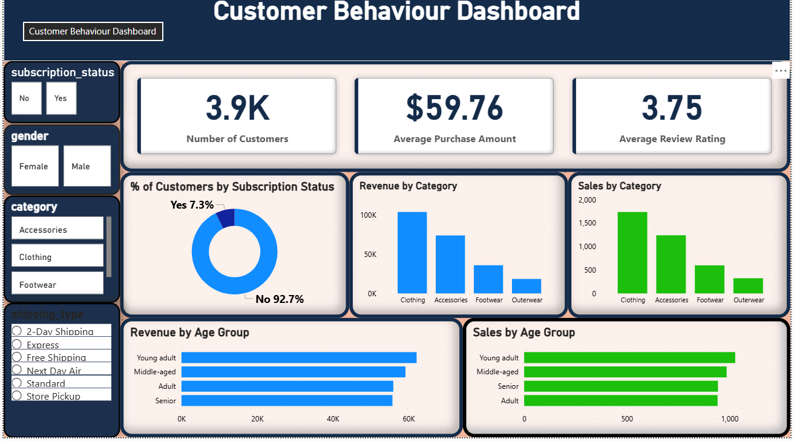

# Customer Shopping Behaviour Analysis

An end-to-end data analytics project exploring customer demographics, purchasing patterns, product categories, discounts, subscriptions, shipping preferences, and age-group revenue. The project uses **Python (Pandas)** for data cleaning and feature engineering, **PostgreSQL** for querying, and **Power BI** for the interactive dashboard.



## Project Overview

The objective is to turn customer transaction-level records into useful business insights. The dashboard provides a high-level view of customer count, average purchase amount, average review rating, subscription status, category revenue and sales, and age-group performance.

## Tools & Technologies

- **Python:** Pandas for data loading, data quality checks, cleaning, and feature engineering
- **Jupyter Notebook:** exploratory data analysis and transformation workflow
- **PostgreSQL:** relational storage and SQL-based analysis
- **pgAdmin 4:** PostgreSQL database administration
- **SQLAlchemy + psycopg2:** Python-to-PostgreSQL connection
- **Power BI Desktop:** interactive report and dashboard

## Dataset

- Records: **3,900**
- Original columns: **18**
- Customer age range: **18–70**
- Product categories: **4**
- Distinct products: **25**
- Geographic locations: **50**

The source CSV contains customer demographics, purchased item/category, purchase amount, location, size, color, season, review rating, subscription status, shipping type, discount/promo usage, previous purchases, payment method, and purchase frequency.

## Workflow

1. **Load data:** imported the CSV into a Pandas DataFrame.
2. **Inspect data:** checked dimensions, data types, descriptive statistics, and missing values.
3. **Clean data:** filled missing `Review Rating` values using the median review rating within each product category.
4. **Standardize columns:** converted column names to lowercase with underscores and renamed the purchase amount field to `purchase_amount`.
5. **Engineer features:** created an age-group field using quartile-based binning and mapped purchase-frequency labels to an approximate number of days.
6. **Remove duplicate information:** the notebook compares `discount_applied` and `promo_code_used`; because they match row-for-row in this dataset, `promo_code_used` is dropped from the transformed DataFrame.
7. **Load to PostgreSQL:** wrote the transformed DataFrame to the `customer` table in the `customer_behaviour` database using SQLAlchemy.
8. **Analyze and visualize:** used SQL questions and Power BI visuals to explore customer and revenue patterns.

## Key Dashboard Metrics

| Metric | Result |
|---|---:|
| Number of customers | 3,900 (3.9K) |
| Total purchase revenue | $233,081 |
| Average purchase amount | $59.76 |
| Average review rating | 3.75 / 5 |
| Missing review ratings before cleaning | 37 |

## Key Findings

### Revenue by gender

- Male customers generated **$157,890** in purchase revenue.
- Female customers generated **$75,191** in purchase revenue.
- The dataset contains 2,652 male and 1,248 female customer records. Revenue totals should be interpreted alongside this difference in record counts.

### Category performance

| Category | Records | Revenue | Average purchase |
|---|---:|---:|---:|
| Clothing | 1,737 | $104,264 | $60.03 |
| Accessories | 1,240 | $74,200 | $59.84 |
| Footwear | 599 | $36,093 | $60.26 |
| Outerwear | 324 | $18,524 | $57.17 |

Clothing contributed the highest recorded revenue ($104,264) among the four categories.

### Subscription comparison

| Subscription status | Records | Average purchase | Revenue |
|---|---:|---:|---:|
| No | 2,847 | $59.87 | $170,436 |
| Yes | 1,053 | $59.49 | $62,645 |

In this dataset, subscribers' average purchase amount was **$59.49**, compared with **$59.87** for non-subscribers. This is a descriptive comparison, not evidence that subscription status causes spending changes.

### Shipping comparison

- Express shipping average purchase: **$60.48**
- Standard shipping average purchase: **$58.46**

### Revenue by age group

| Age group (quartile-based) | Records | Revenue | Average purchase |
|---|---:|---:|---:|
| Young adult | 1,028 | $62,143 | $60.45 |
| Adult | 942 | $55,978 | $59.42 |
| Middle-aged | 986 | $59,197 | $60.04 |
| Senior | 944 | $55,763 | $59.07 |

## SQL Analysis Questions

The SQL script explores questions such as:

1. What is total purchase revenue by gender?
2. Which discount-using customers spent at least the overall average?
3. Which products have the highest average review ratings?
4. How do average purchase amounts compare for Standard and Express shipping?
5. Do subscribers and non-subscribers differ in customer count, average spend, and revenue?
6. Which products have the highest discount-use rates?
7. How can customers be segmented by previous purchases?
8. What are the top three purchased products within each category?
9. How many repeat buyers are subscribed versus not subscribed?
10. How much revenue does each age group contribute?

## Repository Structure

```text
customer-shopping-behaviour-analysis/
├── Customer_Shoping_Behaviour_Ananlysis.ipynb
├── customer_behaviour.sql
├── customer_shopping_behavior.csv
├── dashboard.png
└── README.md
```

## How to Reproduce

1. Clone or download this repository.
2. Install the Python dependencies:
   ```bash
   pip install pandas sqlalchemy psycopg2-binary jupyter
   ```
3. Open the notebook in Jupyter and update the CSV path to the location on your computer.
4. Create a PostgreSQL database named `customer_behaviour`.
5. Update the database connection settings in the notebook using your own local credentials. **Do not commit passwords or secrets.**
6. Run the notebook cells in order to clean and load the data into the `customer` table.
7. Open `customer_behaviour.sql` in pgAdmin 4 or another PostgreSQL client and run the analysis queries.
8. Open the Power BI `.pbix` report (if included in your repository) and update the data source connection to your local PostgreSQL instance.

## Data Quality Notes & Limitations

- The original CSV has **37 missing review ratings**. The notebook fills them with the median rating for the corresponding category.
- The notebook's purchase-frequency mapping should be checked against the exact source labels. In the current notebook, `Annualy` is misspelled relative to `Annually`, and the `Every 3 months` label may not match the CSV's capitalization (`Every 3 Months`). Those values can therefore become null in the engineered day-count column unless normalized.
- The SQL file contains an unfinished query for the subscriber comparison (`roavg` is not a valid SQL function and the query is incomplete). Complete and test that query before presenting it as an executed analysis.
- The discount-rate expression in the SQL file should cast to a decimal/numeric type to avoid integer division in PostgreSQL.
- Age groups are created using quartiles, so boundaries depend on the distribution of ages in this dataset.
- The dataset is observational and supports descriptive analysis; it does not establish causal relationships.

## Security Before Publishing

The uploaded notebook contains a database password written directly in a code cell. **Change that PostgreSQL password before publishing the notebook**, remove the hard-coded credential, clear sensitive notebook outputs if needed, and use environment variables or a local untracked configuration file instead.

## Author

Add your name, GitHub profile, and contact links here before publishing.
